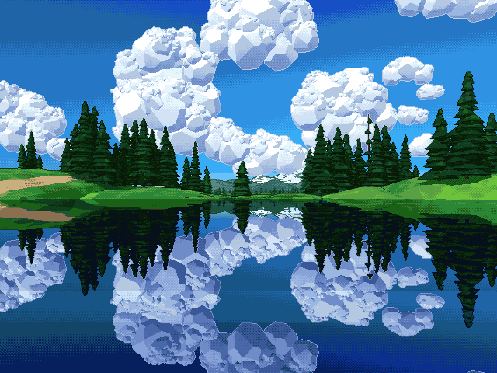

# genvista

A mountain lake from a photo I had as my desktop wallpaper, rebuilt as a tiny
ray caster in the style of the sprite renderer from my game Mans In My House.
Nothing here is the photo: the image above is what the code makes.

How it draws:

- every object is a convex solid, an intersection of planes (lumps, spruce
  skirts, boxes, peaks), hit with a slab test, one ray per pixel
- flat facets lit in four bands, hard shadows, blue-leaning shade, haze
- 3D grain in each solid's own space, per-facet brightness jitter
- hatching in the darkest band, ink lines where one solid passes in front of
  another, outlines against the sky
- a still lake at y = 0 that mirrors the lot, darks darker, whites kept
- a wobbling ray grid, then a 4x4 Bayer dither onto a palette taken from the
  photo, blown up nearest-neighbour

The layout comes from the photo by hand: things are placed by image position
and distance (`place(camera, u, v, z)`); the lumps, puffs and skirts grow from
the seed.

    cmake -S . -B build -G Ninja && ninja -C build
    ./build/genvista                                   # 640x480 x5 -> out/vista.png (3200x2400)
    ./build/genvista --w 640 --h 360 --scale 3 --out out/vista-1920x1080.png
    ./build/genvista --seed 7 --no-palette --dither 0  # other lumps, raw colour

A wider image keeps the full width of the 4:3 layout and shows a band of it
starting `--top` (0.06) of the way down.
